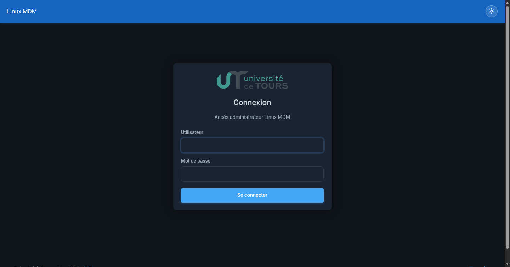
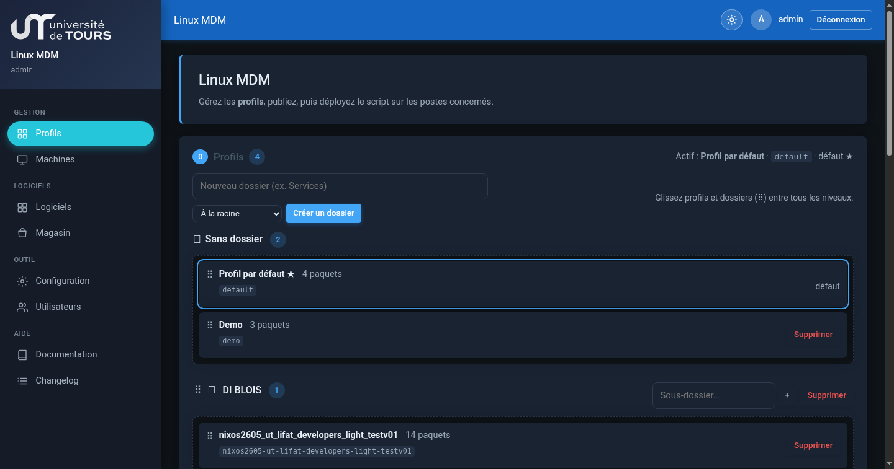
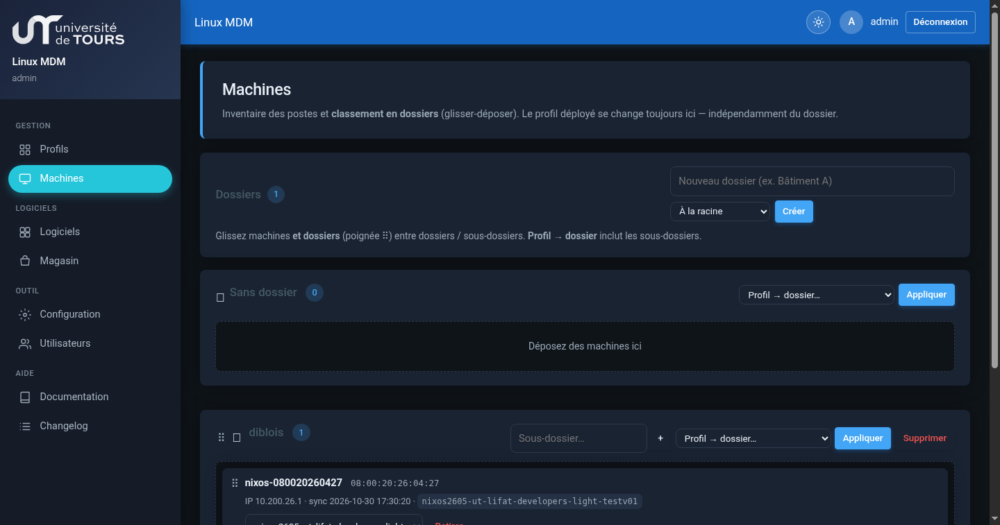
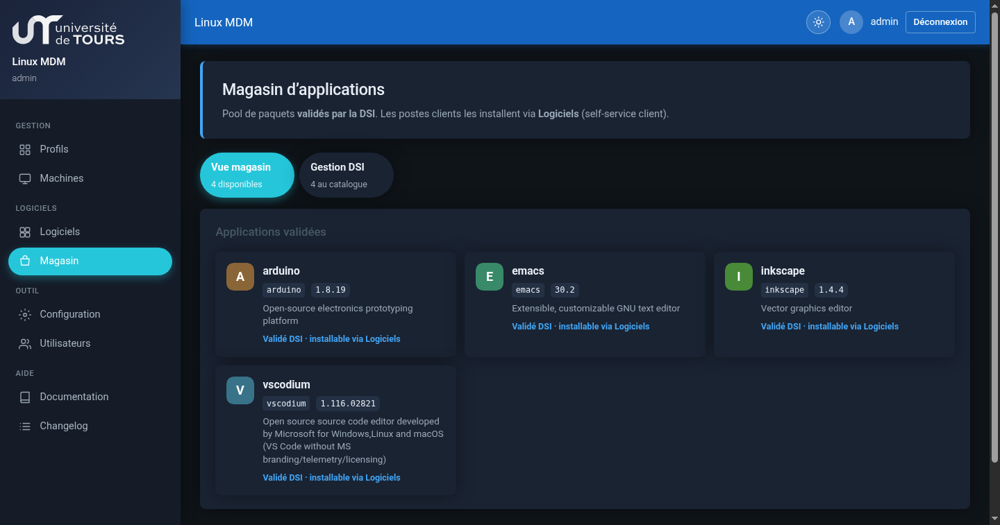
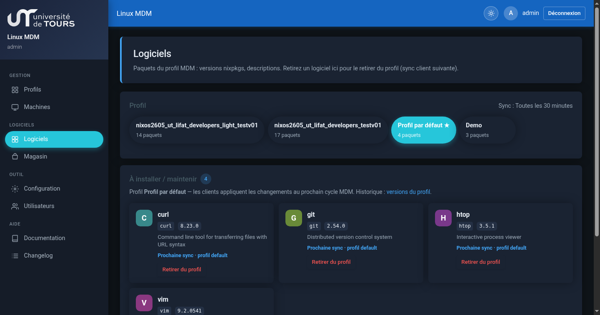
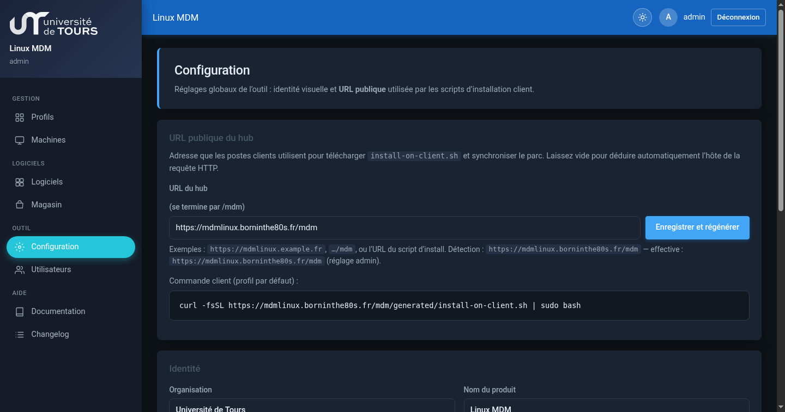

# Linux MDM 0.3.9

MDM pour postes **NixOS** : profils logiciels versionnés, inventaire machines (dossiers), magasin DSI et app client **Centre Logiciels**.

| | |
| --- | --- |
| Version | **0.3.9** |
| Guide | [docs/GUIDE.md](docs/GUIDE.md) |
| Historique | [CHANGELOG.md](CHANGELOG.md) |
| Changelog UI | `/mdm/changelog.php` |

## Captures d’écran

### Connexion



### Profils (dossiers imbriqués)



### Machines



### Magasin



### Logiciels



### Configuration



## Démarrage rapide (serveur)

```bash
cd docker
cp .env.example .env   # mots de passe DB
docker compose up -d --build
```

Ouvrir l’UI MDM (ex. `https://mdmlinux.borninthe80s.fr/`), se connecter, publier un profil.

## Client NixOS

```bash
curl -fsSL https://VOTRE-SERVEUR/mdm/generated/install-on-client.sh | sudo bash
# (URL publique réglable dans Configuration)
```

Le poste s’enregistre avec un hostname `nixos-<mac>`, importe `parc.nix` + `mdm-hostname.nix`, active le timer de sync.

Puis sur le bureau : **Applications → Centre Logiciels**.

## Fonctionnalités principales

- **Profils** : paquets, fréquence, versions / restauration, **dossiers imbriqués** (drag & drop)
- **Machines** : inventaire, profils, **dossiers imbriqués** (drag & drop)
- **Magasin / Logiciels** : catalogue DSI et retrait depuis le profil
- **Centre Logiciels** : self-service, sync immédiate, journal local
- **Configuration** : URL publique du hub, logo / identité (admin)
- **Utilisateurs** : comptes hub, rôles admin / DSI

## Stack

- PHP 8.2 + Apache, MariaDB
- Auth applicative (sessions)
- Sync client : `parc.nix` + timer systemd `nix-builder-mdm-sync`
- Agent local `127.0.0.1:17380` (sync + journal depuis le Centre Logiciels)

## Backup

```bash
./bin/backup-release.sh
```

Archive dans `storage/backups/` (code + dump SQL, hors store Nix).
